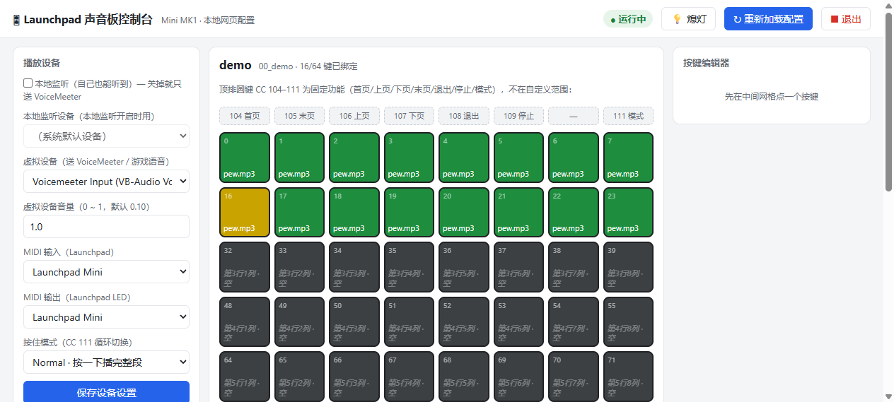

# lolPing / Mcfloy launchpad — MK1 适配版

把 [Mcfloy/launchpad](https://github.com/Mcfloy/launchpad)（Rust 声音板）适配到
**Launchpad Mini MK1（初代，USB `VID_1235&PID_0036`）**。

上游只支持 MiniMK2 / MiniMK3 / X，MK1 直接用会 `panic!("Launchpad not found")`。

## 快速开始

二进制已编译好：

```
target\release\launch-soundpad.exe
```

**直接双击运行**：右下角托盘出现图标，双击托盘图标打开设置页（详见下面「独立 exe」一节）。
程序会自己找 `config.yaml`（当前目录 → exe 同目录 → 往上几层），所以放在 `target\release` 里也能跑。

想看日志就在 cmd 里带 `--console` 运行，正常会打印识别到的型号：

```
[INFO launch_soundpad] Launchpad model detected: MiniMk1
```

`pages\00_demo` 用仓库自带的 `pew.mp3` 占住了前两行 16 个 pad，
**先按这几个验证发声和背光**，再加自己的音频。

## MK1 与 MK2/MK3 的关键差异（适配核心）

| | MK1（本版） | MK2 / MK3 / X（上游） |
|---|---|---|
| 网格 note | `16×行+列`，左上角 **note 0** | `11`–`88`，跳过 19/29/39… |
| 网格范围 | 0–7, 16–23, 32–39 … 112–119 | 11–18, 21–28 … 81–88 |
| 右列圆键 | note `8,24,40,56,72,88,104,120` | note `89,79,69,59,49,39,29` |
| 顶排圆键 | CC 104–111 | CC 104–111 |
| LED 颜色 | velocity = `16×绿+红+12`（三色） | RGB 调色板索引 |
| 编程模式 | 无 SysEx，默认 X-Y | 需 SysEx 进入 programmer mode |

### MK1 LED 速度值（实测校正）

MK1 没有 RGB 调色板，颜色由 velocity 决定：**velocity = 16×绿 + 红 + 12**（12 是普通模式标志位）。
下面的 RGB 是拿手机拍下实物、按按键中心采样出来的值，用来定名（相机把红通道压到 ~250，绿通道和比值可靠）：

| 颜色 | velocity | 实测 RGB | 说明 |
|---|---|---|---|
| 灭 | 12 | (114,114,98) | 不发光（照片里是塑料壳的环境色） |
| 红 暗 / 亮 | 13 / 15 | (250,33,54) / (250,26,41) | 13 偏粉红、15 最亮 |
| 绿 暗 → 亮 | 28 / 44 / 60 | (133,196,3) → (135,215,3) → (154,229,2) | 60 最亮、略偏黄绿 |
| 橙 暗 | 29 | (244,139,15) | 绿1红1 |
| 橙 亮 | 63 | (249,134,9) | 绿3红3，最饱和的暖色 |
| **黄（最黄）** | **61** | (248,192,15) | 绿3红1，G/R≈0.77——**比 62 更黄** |
| 橙黄 | 62 | (253,174,15) | 绿3红2，介于 61 和 63 之间 |
| 橙 | 45 / 46 / 47 | (253,147,10) / (251,131,12) / (249,115,11) | 绿2配红1/2/3 |

- 播放中的 pad 用 **63（橙亮）**；`led_message()` 里上游的「yellow(13)」映射到 **61**（原来错写成 62）。
- 想自己复现：设置页中间那栏最下面有 **「LED 颜色测试」** 卡片（①8 种颜色 ②4×4 绿红组合 ③全色阶 12-63 ④熄灭），
  点亮后对照页面上的对照表看实物即可。
- 用手机拍下点亮的板子，再 `python gui/led_read_photo.py <照片>` 就能把每个键的实际 RGB 采样出来
  （`gui/led_map.py <照片>` 会打一张字符颜色地图，方便先确认按键位置）。

## 按键布局（MK1）

| 位置 | 功能 |
|---|---|
| 8×8 网格 | 播放当前页的声音 |
| CC 104 / 105 | 第一页 / 最后一页 |
| CC 106 / 107 | 上一页 / 下一页（**切语言包就靠这个**） |
| CC 108 | 退出程序 |
| CC 109 | 停止全部 |
| CC 111 | 切换 hold-to-play 模式（普通/停止/暂停） |
| 右列 note 8,24,40,56,72,88,120 | 书签（bookmark）切换 |

> 右列 note 104 故意留空——它和顶排 CC 104（第一页）在程序里是同一个数字，会冲突。

## 接入游戏语音（VoiceMeeter）

`config.yaml` 里 `virtual_device: Voicemeeter In 3`，声音会同时送到：

- `output_device`（留空 = 系统默认设备，你这里是 Voicemeeter Input）——本地监听
- `virtual_device`（Voicemeeter In 3）——送进 VoiceMeeter

在 VoiceMeeter Potato 里这样接：

1. **硬件输入**选 `头戴式麦克风 (A50 X Mic)`
2. **虚拟输入 Voicemeeter In 3**（声音板）勾到 **Bus B1**
3. 麦克风那条也勾到 **Bus B1**
4. Bus B1 会以 `Voicemeeter Out B1` 的形式成为一个可录音设备
5. **游戏内语音的麦克风选 `Voicemeeter Out B1`**
6. 本地监听：把默认设备进来的那路（In 1）勾到 Bus A1，A1 输出到头戴式耳机

这样队友能同时听到你的说话和声音板，音量在 VoiceMeeter 里分开调。

> 注意：Voicemeeter In 3 和麦克风**都**要勾到 B1，只勾一个的话队友就只听到一边。
> 如果出现声音重复，检查是不是 In 1 和 In 3 都被勾到了 B1——只留 In 3 走 B1，In 1 走 A1 监听。

### 只走 VoiceMeeter（关掉本地监听）

默认行为（和上游一致）是**本地设备 1.0 + 虚拟设备 0.10 各播一遍**。
只想让声音进 VoiceMeeter、自己耳机里不听，改 `config.yaml`：

```yaml
local_monitor: false   # 关本地监听：完全不建本地输出流，声音只送虚拟设备
virtual_volume: 1.0    # 送虚拟设备的音量（缺省 0.10，可 0 ~ 2）
```

界面上对应「播放设备」卡片里的 **「本地监听」勾选框** 和 **「虚拟设备音量」**输入框，改完点保存即可。

- `local_monitor` 缺省 `true`，写成 `false / 0 / no / off` 都算关。
- 关掉本地监听后，**声音只会出现在虚拟设备上**：如果虚拟设备选错了（比如选了 VoiceMeeter 的别的输入口），
  你会完全听不到声音——检查界面里「虚拟设备」选的是不是语音链路里用的那一路。
- 验证方法：启动日志里会有一行
  `Local monitor disabled (local_monitor = false): sounds only go to the virtual device`。

## 加自己的语言包

音频放文件夹，一个文件夹 = 一页 = 一个语言包：

```
sounds/
  中文/      a.wav  b.wav  c.wav ...
  日本語/    x.wav  y.wav ...
  English/   ...
```

然后重新生成页面：

```bash
python gen_pages.py              # 扫描 ./sounds
python gen_pages.py <其他目录>   # 或指定目录
```

每个语言包最多 64 个音频（MK1 网格就 64 个 pad），多了会截断。
`pages/00_demo` 是演示页，重新生成时不会被删。

当前 `sounds/` 里有几个 `clip_0/1/2.wav` 是我造的测试音频，验证完链路后删掉即可。

## 独立 exe（托盘程序 + 内嵌设置页）

`target\release\launch-soundpad.exe` 就是完整程序：**声音板 + 设置界面都在里面**，
设置页（HTML）是编译期嵌进 exe 的，不需要 Python、不需要额外文件。

### 日常使用

1. 双击 `launch-soundpad.exe`
2. 右下角**托盘**出现图标（初始会弹一条气泡提示），**不会**有任何控制台窗口
3. **双击托盘图标** → 浏览器打开设置页 `http://127.0.0.1:8787/`
4. 右键托盘图标 → 菜单：

| 菜单项 | 作用 |
|---|---|
| 打开设置页 | 打开浏览器设置页 |
| 重新加载配置 / 页面 | 重读 `config.yaml` 和 `pages/`，**不用重启程序** |
| 熄灭 Launchpad 灯 | 关掉所有 LED（程序被强杀后灯常亮时用） |
| 退出 | 退出程序（同时撤掉托盘图标、熄灭 Launchpad） |

- **已在运行**时再双击 exe：不会开第二个实例，只会把你的设置页打开（单实例保护）。
- 设置页里改完设备/页面后，点右上角 **「↻ 重新加载配置」** 就生效。
- 想放别的地方运行：把 exe 和 `config.yaml`、`pages/`、`sounds/` 放同一个文件夹里即可
  （程序会先找当前目录的 config.yaml，再找 exe 同目录、以及往上几层，所以放在 `target\release` 里也能跑）。

### 命令行参数（一般用不到）

```
launch-soundpad.exe --console    # 挂到当前控制台，显示日志（cmd 里调试用）
launch-soundpad.exe --open       # 启动时顺便把设置页打开
```

配置/设备出问题时会弹对话框提示（比如 `config.yaml` 里 `midi_out_device` 是空的），不会静默退出。

### 第一次运行会自动准备（不用手写配置）

把 exe 拷到一个空文件夹里双击，它会自己建好：

| 缺什么 | 自动做什么 |
|---|---|
| `config.yaml` | 探测 MIDI 端口和音频设备，生成一份：优先挑 VoiceMeeter/VB-Cable 当虚拟设备；没有的话就关掉本地监听、只往默认输出播一遍。同时写上 `sounds_dir: sounds/语音包` |
| `sounds/语音包/` | 建好这个语音包文件夹 + 「把音频放这里.txt」 |
| `pages/` | 语音包里有音频就自动生成一页（按文件名顺序填 64 个键）；没有就先放一个空的 `00_demo` |

做过什么都写在设置页底部的**活动日志**里。设备名不对、音频设备打不开、`config.yaml` 解析失败这类问题，
会**弹对话框说明该改哪个字段**，不会静默退出（原来是直接 panic 或者悄无声息地结束）。

### 语音包路径（`sounds_dir`）— 一个路径就够了

默认只需要**一个文件夹**放音效：

```
<exe 所在目录>/
  config.yaml            ← 数据根目录，程序自动定位；这里写着 sounds_dir
  sounds/语音包/          ← 把音频（wav/mp3/ogg/flac/m4a）直接丢进来
      clip_0.wav
      clip_1.wav
  pages/01_语音包         ← 每行：note;音频路径;颜色
```

- `config.yaml` 里的 **`sounds_dir`** 就是那个路径：可以写相对路径（相对数据目录），也可以写绝对路径，
  例如 `sounds_dir: D:\我的音效` —— 指向哪儿就用哪儿的音频。
- 设置页「语音包」卡片上也能直接改这个路径（改完点「保存路径」），有「📂 打开」按钮直接打开那个文件夹。
- **留空**（或删掉那一行）= 回到多语音包模式：`sounds/` 下每个子文件夹各算一个语音包（例如 `sounds/中文`、`sounds/日本語`），
  一包对应一页。要按语言分类时用这个。
- 页面里存的是**相对路径**（能相对就相对，指到数据目录外才用绝对路径），所以整个文件夹拷到别的盘/别的电脑，绑定依然有效。
  在设置页里绑定或上传音频时也会自动这么存；`gen_pages.py` 生成的页面同理。

### 附：Python 版控制台（开发用，可选）

`启动界面.bat` + `gui/gui_server.py` 是早期做的 Python 版控制台，功能一样（设备枚举走 sounddevice、
试听走 soundfile），但依赖 Python 环境。现在 exe 自带界面，这个留作调试/对照用。二者接口相同，
`gui/index.html` 是共用的。

### 设置页能干什么



| 区域 | 能干什么 |
|---|---|
| 播放设备 | 关/开**本地监听**、选本地监听设备 / 虚拟设备（Voicemeeter）/ 虚拟设备音量 / MIDI 输入输出 / hold 模式，一键存回 `config.yaml`（bookmark、debug_mode 等原样保留） |
| 页面 | 新建 / 改名 / 删除页面；「文件夹生成」= 把整个语言包按文件名顺序填进 64 个键 |
| 8×8 网格 | 点键编辑：选文件绑定、拖拽音频文件到键上直接上传并绑定、双击试听、清空、设空闲 LED 颜色 |
| 按键测试 | 直接看 Launchpad 送进来的按键：显示 note 号并高亮网格。排查「按实体键没反应」用——有事件=信号正常，没事件=USB/驱动问题 |
| 顶栏 | 「↻ 重新加载配置」（重读 config.yaml + pages，不用重启）、「■ 退出」、💡 熄灯；底部是活动日志 |

改动即时写盘（`pages/` 文件格式不变），**改完点「↻ 重新加载配置」生效**。

## 相对上游改了什么

| 文件 | 改动 |
|---|---|
| `src/launchpad/mod.rs` | 新增 `MiniMk1` 变体；MK1 的 note 映射 / 书签 / 停止键；`led_message()` 做三色 velocity 转换；`grid_notes()` 生成 MK1 网格；设备名识别加 `Launchpad Mini` |
| `src/midi.rs` | `clear_grid` 改为按模型清网格（修掉上游从 note 1 开始、漏掉 MK1 左上角 note 0 的问题）；MIDI 设备名改子串匹配；表头改为每次刷新都重画（修掉上游翻页后表头熄灭） |
| `src/main.rs` | LED 发送走 `led_message()`；`end_session` 传 launchpad；`output_device` 为空时用默认设备（上游会 `unwrap()` panic）；加型号识别日志；新增 `local_monitor` 开关（关闭时不建本地输出流，只走虚拟设备）+ `virtual_volume` 控制虚拟设备音量（sinks 改为 `(Option<Sink>, Sink)`）；起内嵌设置页 + 托盘；哨兵 note 126/127 = 重载/退出；自动定位 config.yaml 所在目录；单实例保护；配置错了弹对话框而不是静默 panic |
| `src/webui.rs` | **新增**：内嵌设置页（`include_str!` 把 `gui/index.html` 编进 exe）+ 本地 HTTP API（设备枚举走 cpal/midir、config/pages 读写、试听、熄灯、按键事件、重载、退出、LED 颜色测试）；新增 `sounds_dir`（语音包路径）支持——设了就只认那一个文件夹，留空则 `sounds/` 下每个子文件夹各一包 |
| `src/setup.rs` | **新增**：首次运行自动准备——缺 `config.yaml` 就探测设备生成、缺语音包目录就建 `sounds/语音包/`、`pages/` 为空就用语音包里的音频生成页面 |
| `src/tray.rs` | **新增**：Windows 托盘（隐藏窗口 + Shell_NotifyIconW + 右键菜单），图标是运行时用 GDI 画的 |
| `Cargo.toml` | 新增 `serde_json`、`tiny_http`（内嵌 HTTP）、`windows-sys`（托盘/对话框/单实例） |
| `gui/index.html` | 共用界面：设备/页面/网格编辑 + 按键测试；顶栏适配内嵌模式（重新加载/退出）；保存配置只提交改过的字段（防止旧页面把别处的改动覆盖掉）；`/api/preview` 改传设备名 |
| `src/config.rs` | 新增 `local_monitor` / `virtual_volume` 两个键（都按字符串宽松解析，缺省分别是 `true` / `0.10`，保持上游行为） |
| `src/midi.rs` | `stop_note` 适配 `(Option<Sink>, Sink)` |
| `src/audio.rs` | 设备名改子串匹配；空名回退默认设备 |
| `src/referential.rs` | 页面文件排序（`read_dir` 顺序不固定）；目录不存在时不再 panic |
| `build.bat` | 绕开 `vcvars64.bat`（它调 `reg.exe` 会被沙箱拦），手写 `LIB`/`INCLUDE`/`PATH` |
| `config.yaml` | MK1 的设备名和虚拟设备 |
| `gen_pages.py` | 新增：语音包文件夹 → pages 页面（写相对路径） |

## 编译

```bash
cmd //c build.bat
```

需要 Rust nightly（用了 `let_chains`）+ MSVC。本机已装
Rust 1.101.0-nightly 和 Visual Studio Community 2026。
